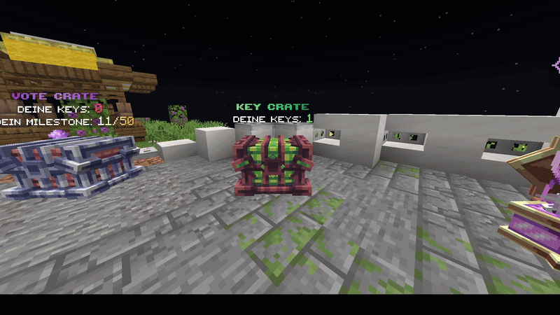
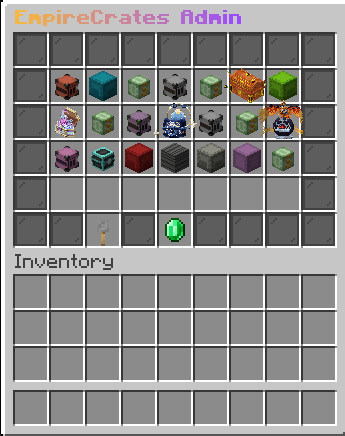
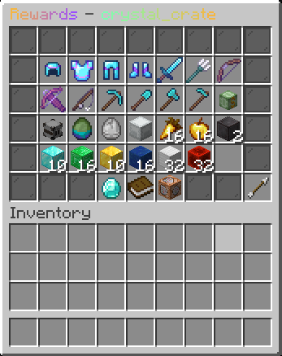

# EmpireCrates

`Java 21 · Paper · Maven · PlaceholderAPI · YAML`

EmpireCrates is a crate-system module from a larger private Minecraft server core. This portfolio version keeps the crate logic, admin workflow and integration points that are useful to review.

The full private core is not included. The public version focuses on command handling, inventory GUIs, chat prompts, YAML persistence, optional plugin integrations and runtime visual behavior.

## Overview

This project keeps the crate gameplay logic, editor workflow, persistence and optional integrations in one reviewable module.

<p align="center">
  
</p>

<p align="center"><sub>In-game crate showcase and opening system</sub></p>

## Key Features

### Crate Configuration

- YAML-backed crate definitions in `crates.yml`
- Configurable crate item, key item, display name and key requirement
- Per-crate opening animation and aura settings
- Optional milestone rewards after a configured number of openings
- Bundled example crate data installed when no crate configuration exists yet

### Physical Keys

- Physical crate keys are created through `MarkedItems.markKey(...)`
- The generated item receives a plugin-scoped `PersistentDataContainer` value named `key_id`
- Opening a key-required crate scans the player's inventory for a key whose stored `key_id` matches the crate's configured key ID
- Unmarked items or keys marked for a different crate are ignored
- A matching key stack is reduced by one before the opening animation and reward flow continue

This validates crate keys against lookalike items and wrong-crate keys. It does not claim unique per-item serial numbers or a global consumed-key registry.

### Reward System

- Item rewards and command rewards
- Rarity model with default chance percentages
- Explicit `chance-percent` support per reward
- Broadcast flags for notable rewards
- Legacy weight conversion for older reward configuration
- Optional ExcellentCrates-style item tag parsing for complex item rewards

### Admin Tools

- `/empirecrates admin` inventory management flow
- `/empirecrates set`, `model`, `remove`, `givekey`, `givecrate`, `keyall` and `reload`
- `/keyall` shortcut command for online key distribution
- Tab completion for crate IDs and command arguments
- Chat prompts for editing names, commands, chances and integration values

### GUI System

- Multi-screen inventory editor for crate settings, key settings, reward lists and reward details
- Preview screens for configured rewards
- Click-based editing for reward type, rarity, animation and aura
- Separate holder types for admin, preview and reward editing menus

### Persistence

- `CrateStorage` for crate and reward definitions
- `PlacedCrateStorage` for placed crate locations
- `PlayerProgressStorage` for per-player milestone progress
- Save and reload flow that refreshes runtime crate visuals

### Visuals

- Block-based crate opening flow
- GUI roulette and wheel-style opening animations
- Particle and sound feedback during openings
- Hologram-style reward display behavior
- Optional ModelEngine model IDs with idle, open and close animation names

### Integrations

- PlaceholderAPI expansion for keyall timer information
- Optional ModelEngine support via reflection so the plugin can still run without the dependency
- Optional ItemsAdder/Excellent-style custom item data support through stored item tags

## Showcase

<table>
  <tr>
    <td width="50%" align="center" valign="top">
      <strong>Admin Interface</strong>
      <br><br>
      
    </td>
    <td width="50%" align="center" valign="top">
      <strong>Reward System</strong>
      <br><br>
      
    </td>
  </tr>
</table>

## Technical Structure

The plugin is organized around a small set of focused packages:

- `command`: command dispatch and tab completion
- `gui`: inventory screens, chat prompts and editor state
- `keyall`: scheduled key distribution service
- `listener`: crate placement, interaction, reward delivery and visual opening behavior
- `model`: crate, reward, rarity, animation and aura data structures
- `placeholder`: PlaceholderAPI expansion
- `storage`: YAML-backed crate, placement and player progress persistence
- `util`: text formatting, item helpers, chance calculation and optional integration bridges

## Integrations

- PlaceholderAPI for keyall timer placeholders
- ModelEngine through reflection-based optional support
- ItemsAdder/custom item data through stored item tags

## Requirements

- Java 21
- Paper 1.21.x
- Maven
- PlaceholderAPI optional/provided
- ModelEngine optional
- ItemsAdder optional

## Building

```bash
mvn clean package
```

The generated jar is intentionally not tracked in this portfolio repository.

## Why Included

EmpireCrates is useful as a portfolio centerpiece because it demonstrates how a larger private-core feature is structured internally: configuration, GUI workflows, key validation, persistence, optional integrations and user-facing gameplay behavior are visible without publishing the complete private core.
